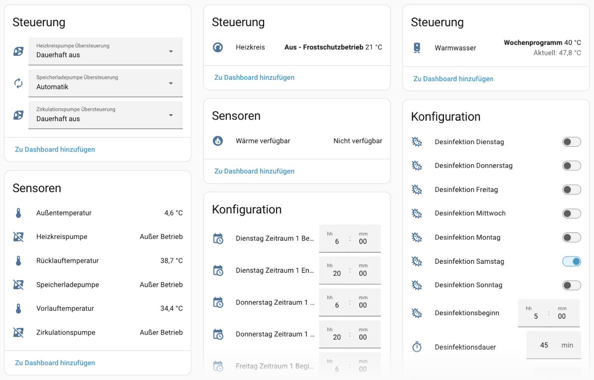

# Danfoss ECL Comfort 310 for Home Assistant

[![HACS Custom][hacs-shield]][hacs]
[![GitHub Release][release-shield]][releases]
[![License][license-shield]](LICENSE)
[![Lint][lint-shield]][lint]
[![Validate][validate-shield]][validate]

A Home Assistant custom integration for **Danfoss ECL Comfort 310** heating and
district heating controllers, over Modbus TCP or a Modbus RTU gateway.

It is the community-testing build of an integration being prepared for Home
Assistant core. The device library it is built on is
[`ecl310-modbus`](https://github.com/k3mpaxl/ecl310-modbus), vendored into
this repository so nothing has to be released to PyPI before you can try it.



*Controller, heating circuit and hot water as they appear in Home Assistant
(German profile language). See [Screenshots](#screenshots) for what each card
shows.*

## What you get

| Platform | Entities |
| :------- | :------- |
| Climate | The heating circuit as a thermostat: comfort room setpoint, operating mode as HVAC mode plus a preset for the exact ECL mode, circuit status driving the HVAC action |
| Water heater | Domestic hot water: setpoint and operating mode, with the S6 storage temperature as the current temperature |
| Sensor | Outdoor, flow, return and storage temperature (named after the application's sensor assignment, see *Applications*); operating mode and circuit status for both circuits |
| Sensor (targets) | What the controller is working with right now: **desired flow temperature**, the **filtered outdoor temperature** the summer cut-off acts on, the **return limit in force**, and the **desired tank temperature** (A237/A337) or **desired hot water flow temperature** (A266) |
| Number | Heating: heat curve and its six points, setback room setpoint, summer cut-off, minimum and maximum flow temperature, return limit, frost protection, pump post-run. Hot water: setback setpoint, return limit, maximum charging temperature, the three charging differences, disinfection temperature and duration, both frost limits |
| Time | The weekly programs: three comfort periods a day, start and end, for the heating circuit and for hot water - 84 entities, of which the first period of each day is enabled. Plus the start of the anti-bacteria run |
| Select | Forcing the heating circuit, storage charge and circulation pump: *Automatik*, *Dauerhaft aus*, *Dauerhaft ein* - where the application's relay assignment is known |
| Switch | The automatic pump shutdown during setback, hot water priority, the disinfection itself and the seven weekdays of the anti-bacteria run; **Hot water boost** and its *Boost when the setpoint is raised* setting (see below) |
| Sensor (boost) | While a hot water boost runs: start temperature, how long it has been running, and when it should be done |
| Binary sensor | The three named pumps; **Heat available** on the heating circuit (see below); plus the six triacs and the unnamed relays, diagnostic and disabled by default. With an unknown relay assignment the six relays show by number, enabled |

The target sensors read values the controller computes and does not let you
set (Danfoss *communication description*, 9.1). They answer most "why is it
doing that?" questions. For example, the heating stays off while the filtered
outdoor temperature is above the summer cut-off, even when it is colder outside
right now. In frost protection the desired flow drops to the frost limit. When
the controller has no target, it reports 192.00 °C, which these sensors show as
*unknown*.

The heating circuit and hot water appear as sub-devices of the controller. Every
number entity takes its range and step from the library's datapoint metadata, so
the bounds the UI enforces are the ones the controller accepts, and an invalid
value is refused before a register is written.

## Screenshots

The integration creates three devices: the controller itself and, as its
sub-devices, the heating circuit (*Heizkreis*) and hot water (*Warmwasser*).
The picture above shows their device pages, left to right:

* **Controller** - the three pump overrides (*Automatik*, *Dauerhaft aus*,
  *Dauerhaft ein*) and the live readings: outdoor, flow and return
  temperature, and whether each pump is running.
* **Heating circuit** - the thermostat, showing its HVAC mode and the exact
  ECL mode as preset (here *Aus - Frostschutzbetrieb*: switched off, frost
  protection only), the **Heat available** sensor, and further down the
  weekly program and the heat curve.
* **Hot water** - the water heater with its setpoint and the measured storage
  temperature, followed by the anti-bacteria run: its weekdays, start,
  duration and temperature.

The settings in the *Konfiguration* card are ordinary number, time and switch
entities, so they can be used in automations and dashboards like any other.

## Heat available – for radiator valves

The heating circuit carries a derived binary sensor, **Heat available**
(*Wärme verfügbar*). It is on while the circuit is actually delivering heat:
the heating pump runs **and** the circuit is in comfort – constant comfort, or
the weekly program inside a comfort period or heating up for one. Setback,
frost protection and a summer cut-off (which stops the pump) count as no heat.

Radiator valves can use it. A Danfoss Ally eTRV takes it as *HeatAvailable*
(cluster 0x0201, attribute 0x4030): told that no heat is available, it switches
to boiler mode and stops requesting heat the system is not supplying. The
[Danfoss Ally Coordinator](https://github.com/k3mpaxl/danfoss-ally-coordinator)
can forward this sensor to every valve it coordinates. Choose it there as the
heat source.

## Hot water boost

Raising the hot water setpoint does nothing outside a comfort period of the
weekly program: the controller only charges the tank in comfort. **Hot water
boost** (*Einmal aufheizen*) on the hot water device puts the circuit into
constant comfort, watches the storage temperature on S6, and puts the previous
mode back as soon as the tank reaches the setpoint - one tap for a hot shower,
and the weekly program carries on afterwards.

* **Boost when the setpoint is raised** (*Aufheizen, wenn das Ziel steigt*, a
  configuration switch, off by default) starts a boost by itself whenever the
  setpoint is set at least 1 K above the tank through Home Assistant.
* While it runs, the switch's attributes and three sensors show the start time
  and temperature, how long it has been running, the heating rate in K/min and
  when the tank should be there.
* It gives up after three hours, and a mode chosen meanwhile - by hand or by an
  absence automation - wins: the boost ends and leaves that mode alone.
* A running boost survives a restart of Home Assistant as long as the
  controller is still in comfort.
* Every boost ends with an `ecl310_hot_water_boost_finished` event carrying
  `result` (`reached`, `timeout`, `cancelled`, `mode_changed`),
  `start_temperature`, `end_temperature`, `target`, `duration_minutes`,
  `started_at`, `previous_mode` and the `user_id` of whoever started it - enough
  for an automation that tells that person their water is ready.

## Where the register map comes from

Danfoss's own manual gives every setting's parameter ID and every input's
sensor number, but never a register address or a write behaviour - only
`11179` (`Sommer-Aus`) or `S1`, not what happens on Modbus. The Danfoss ECL
Tool's configuration YAML export pins down the block layout: which holding
register a parameter or sensor lives at, and the state/override/manual
triplet each relay has.

Neither source says how those registers *behave*. That came from testing
against a live controller - a Danfoss ECL Comfort 310, order number 087H3040,
application key A237.1 V04, software 1.56, over Modbus/TCP on unit 1:

* **Write patterns.** Which register in a group actually has to be written
  for a change to take effect, and which registers only look writable - the
  state register answers a write with a Modbus exception, the override
  register is the one that works.
* **Relay functions.** What each relay's override, state and manual register
  actually does: manual reflects what was forced at the controller's own
  display, outranks the override, and cannot be cleared over Modbus; the
  override takes effect within a couple of seconds and is not time-limited.
* **Wiring, not just addressing.** The parameter tables say a relay or sensor
  slot exists; they don't say a pump is plugged into it. Which relay drives
  which physical output, and which sensor input is actually connected, was
  confirmed by switching outputs and watching the plant respond.

A full poll is 23 block reads and takes about 200 ms. The two weekly programs
are 14 further reads, about 100 ms, fetched on their own slower cadence.

## Requirements

* Home Assistant 2026.9.0 or newer, which needs Python 3.14.2 or newer.
* An ECL Comfort 310 or 310B with the Modbus interface enabled, reachable over
  the network - either directly, or through a serial gateway.
* The controller's Modbus station address, set on the controller under
  *Allgemeine Reglereinstellungen → System → Modbus-Adresse*.

## Installation

### HACS (recommended)

1. In HACS, open the three-dot menu and choose **Custom repositories**.
2. Add `https://github.com/k3mpaxl/ecl310-hacs` with category
   **Integration**.
3. Install **Danfoss ECL Comfort 310** and restart Home Assistant.
4. Go to **Settings → Devices & services → Add integration** and search for
   *Danfoss ECL Comfort 310*.

### Manual

Copy `custom_components/ecl310` into your Home Assistant `config/custom_components`
directory and restart Home Assistant.

## Configuration

Everything is set up from the UI. The config flow asks for:

| Field | Meaning |
| :---- | :------ |
| Host | The controller's IP address or hostname, or that of its Modbus gateway |
| Port | The TCP port the Modbus interface listens on, usually `502` |
| Modbus unit | The controller's station address |
| Framing | `socket` for native Modbus TCP; `rtu` for a transparent serial gateway that forwards RTU frames |

The flow reads the controller before it creates the entry, so a wrong address,
unit or framing is reported immediately rather than showing up as an
unavailable device later. It then asks which application the controller runs,
with the one it detected already selected - see below.

## Device information

The controller reports what it is (Danfoss *communication description*
VI.LG.V5.02, §6.12, pointed out in
[issue 32](https://github.com/k3mpaxl/ecl310-hacs/issues/32)). The device page
shows:

* the application as the model ID, e.g. `A237.1 V04`
* the software version as firmware (e.g. `1.56`)
* the hardware revision (e.g. `H.3`)
* the serial number

Diagnostics also include the code number, build and production week. They
leave the serial number out, so a download can be shared.

## Applications

An ECL Comfort 310 runs one *application* - A237.1, A337.2 and so on, shown on
the controller's start screen - and the application decides which parameters
the controller has. A parameter it lacks is refused over Modbus. The
integration carries a profile for each application it knows: the parameters
that application has, generated from Danfoss' ECL Tool reports.

| Application | Profile | Tested on |
| :---------- | :------ | :-------- |
| A237.1 | V04 | the controller this integration was built on |
| A337.2 | V02 | a controller in the field ([issue 13](https://github.com/k3mpaxl/ecl310-hacs/issues/13)) |
| A266.10 | V03 | not yet - help welcome ([issue 35](https://github.com/k3mpaxl/ecl310-hacs/issues/35)) |

* **Detection.** The controller reports its application and version
  (PNU 2060-2063), and the setup suggests that profile.
  * If the controller reports an application without a profile here, the setup
    names it and suggests *Other application*.
  * Only a controller that reports nothing is probed: the integration reads a
    handful of parameters that some applications have and others lack.
  * An entry set up with an older version detects its application once, at
    the first start.
* **A wrong choice is flagged.** If the application chosen in the setup is not
  the one the controller reports, a repair notice says so until you change it.
* **Named after the application.** What a sensor input measures depends on the
  application:
  * On A266.10, S2 is the secondary return, S4 the hot water flow and S6 the
    hot water return. On A237/A337, S6 is the storage tank.
  * The pumps are named after what they drive where the application's relay
    assignment is known. Otherwise the relays are shown by number, and the
    pump overrides and *Heat available* are left out.
* **Only what exists.** With a profile, the integration reads only the
  parameters that application has, and creates entities only for those.
  Entities an older version created for a parameter the application lacks are
  removed.
* **Changing it.** *Configure* on the integration lets you pick another
  application; the integration reloads.
* **Other applications.** Choose *Other application*: every parameter is read,
  and the ones the controller refuses are found at runtime and their entities
  stay unavailable - the behaviour before profiles existed. To get a profile
  for your application, open an issue with the application and version from
  the controller's start screen and a diagnostics download.

## How it addresses the controller

The ECL documentation never prints register addresses. It labels settings with a
**parameter ID** such as `11179` (`Sommer-Aus`) and inputs with a **sensor
number** such as `S1`. The controller exposes ECL parameter *n* at holding
register *n − 1*, and sensor `Sn` at holding register `10199 + n`. The library
does that conversion, so a datapoint is declared with the reference the manual
prints:

| Entity | ECL reference |
| :----- | :------------ |
| Thermostat setpoint | parameter 11180, comfort room temperature |
| Setback temperature | parameter 11181 |
| Summer cut-off | parameter 11179 (0…50 °C; 0 = off) |
| Minimum / maximum flow temperature | parameters 11177 / 11178 |
| Pump off during setback | parameter 11021 (`Pumpe HK Aus` / `Total stop`) |
| Heating circuit pump | relay 1, state 4005, override 4065 |
| Storage charge pump | relay 2, state 4006, override 4066 |
| Circulation pump | relay 3, state 4007, override 4067 |
| Hot water setpoint | parameter 12190 |
| Disinfection temperature | parameter 12125 |
| Temperatures | sensors S1, S3, S5, S6 |

Heating is ECL circuit 1 (`11xxx`), domestic hot water is circuit 2 (`12xxx`).

A relay is controlled through its **override** register, never its state
register: the state is a result and the controller answers a write to it with a
Modbus exception. The override takes three values - `0` hand it back to the
regulation, `1` hold it off, `2` hold it on - and the output follows within a
couple of seconds. The relays' manual registers (`4025`…`4030`) say what an
operator forced at the controller's own display; that outranks the override and
cannot be written over Modbus.

## Known limitations

* **The controller serves holding registers only.** It answers a coil read with
  `illegal function`, so on/off settings are read and written as `0`/`1` in the
  register table - the same thing a YAML `modbus:` switch does, whose
  `write_type` defaults to `holding`.
* **Forcing a pump holds it until you release it.** The three pump selects
  write the controller's override register, and nothing times it out: an
  output left on *Dauerhaft ein* stays on until the select is put back to
  *Automatik*. Verified on the controller - the override was still standing
  after 30 seconds and released cleanly.
* **The controller's own display outranks the override.** If someone puts an
  output into manual mode at the ECL itself, that wins, and the override
  register then says what was asked for rather than what the output is doing.
  Modbus cannot clear it; only the controller can. There is no entity for it -
  the diagnostics download carries registers `4025`…`4030` raw, which is where
  to look when an override appears to do nothing.
* **An unconnected sensor input reads as 192.00 °C**, the controller's
  no-sensor value. Those entities report *unknown* instead.
* **Sensor assignment follows application key A237/A337.** If your controller
  runs a different application, S3/S5/S6 may carry something else. The raw
  values are still correct; only the names would be wrong.
* **The disinfection is switched off by its temperature.** The controller
  stores `9` in the disinfection temperature to mean *off* (its display shows
  `OFF`). The temperature entity then reads *unknown*, and the *Disinfection*
  switch turns it back on at the temperature it last had - 70 °C if it never
  had one.
* **A device name is fixed when the device is first created.** `Heizkreis` and
  `Warmwasser` are translated at that moment, so switching Home Assistant's
  language later does not rename devices that already exist - as with any
  integration. Entity names follow the language immediately.
* **One connection per config entry.** Home Assistant core is gaining an API for
  sharing one Modbus link between integrations; until it ships, this integration
  opens its own.

## Manual mode is readable, not settable

The controller's five operating modes are `Handbetrieb`, `Wochenprogramm`,
`Komfortbetrieb`, `Sparbetrieb` and `Frostschutzbetrieb` - the manual's own
wording. Four of them can be chosen from Home Assistant. `Handbetrieb` cannot,
because of what the manual says it does:

> Während der manuellen Regelung: Alle Steuerungen müssen deaktiviert sein.
> „Ausgang schreiben" ist nicht möglich. Frostschutzfunktion ist nicht aktiv.
> [...] Wird der Handbetrieb für einen Kreis gewählt, befinden sich automatisch
> auch alle anderen Kreise im Handbetrieb.

It switches off every control loop *and* the frost protection, refuses the
output override the pump selects write, and takes the other circuit with it -
from a dashboard, on a district heating station, in winter. It is a
commissioning mode, chosen at the controller with the installation in front of
you.

It stays fully readable: the mode sensors always report it, and the thermostat
and water heater grow the option back for exactly as long as the controller is
actually in it, so a manual controller says so and can be brought out of it.

## Languages

English and German ship with the integration. Home Assistant picks whichever
matches your profile language, so nothing needs configuring.

Everything the frontend shows is translated: entity names, the enumerated
states of both operating-mode and circuit-status sensors, the thermostat's
presets, the water heater's operating modes, the *Heizkreis* and *Warmwasser*
sub-devices, and the config flow. Where the controller has its own German word
for a setting, that word is used - `Sommerabschaltung`, `Spartemperatur`,
`Modbus-Adresse` - so the integration reads the way the controller's own
display does.

Translations are read when Home Assistant starts and cached by the frontend, so
after replacing the integration restart Home Assistant and reload the browser
page. If a state still shows as `[%key:component::ecl310::…%]`, the copy in your
configuration directory is an older one - check it with:

```bash
grep -c '%key' <config>/custom_components/ecl310/translations/*.json   # must be 0
```

Only the two hot-water sensors were affected: their states referenced the
heating ones, and a reference that is never expanded reaches the frontend as
written. Recorded history is unharmed - Home Assistant stores states as their
plain keys and translates them on display, so past states render correctly once
the files are right.

To add a language, copy `custom_components/ecl310/translations/en.json`, save it
under its language code and translate the values. `scripts/translations` then
checks it against English and names any key that is missing or left over; it
also rebuilds `en.json` from `strings.json`, which is the file to edit when a
string itself changes. `scripts/lint` runs it, and so does CI.

## The weekly programs

Each circuit keeps three comfort periods per weekday. Between the start of a
period and its end the circuit runs at its comfort setpoint; outside them, at
its setback setpoint. Home Assistant has no entity that carries a whole weekly
program, so each boundary is its own `time` entity - 42 per circuit.

Only the first period of each day is enabled. The controller switches a period
off by making it zero-length, so periods 2 and 3 usually read the same value
twice; enable them on the days you actually use them.

If you installed 0.4.0, that release had half of these entities missing: both
programs used the same entity keys, so every boundary collided with its
opposite number and Home Assistant kept whichever it registered first. 0.4.1
gives each circuit its own keys. The entities from 0.4.0 are orphaned by that
and can be deleted from the entity list; anything pointing at them needs
pointing at the new ones.

The programs are read on the first poll and every tenth after it, and again
immediately after one is written. They cost fourteen block reads of their own -
the four registers between one weekday and the next are not served - for values
only an operator changes.

One rough edge: the registers hold `HHMM` and go up to `2400`, which
`datetime.time` cannot express. A register reading `2400` shows as 23:59 and
stays `2400` in the controller until that entity is set.

## Brand images

`custom_components/ecl310/brand/` carries the icon Home Assistant shows for the
integration. It is an original placeholder - a weather-compensation curve, not
a manufacturer's mark. Replacing it with Danfoss' own icon means getting the
asset from Danfoss; it is not something to redraw by hand.

For the icon to appear outside this installation, the domain also has to be
added to [`home-assistant/brands`](https://github.com/home-assistant/brands)
under `custom_integrations/ecl310/`, which wants `icon.png` at 256x256 and
`icon@2x.png` at 512x512, PNG, trimmed, transparency preferred. Until that is
merged, the HACS validation workflow skips its brands check.

## Reporting a problem

Download the integration's diagnostics first - **Settings → Devices & services →
Danfoss ECL Comfort 310 → ⋮ → Download diagnostics**. It contains the raw
register map, undecoded, which is what makes a decoding problem reproducible
without your hardware: it replays straight into the library's test suite.

## Relationship to the core integration

This repository and the core integration share their entities, translations and
coordinator. They differ in exactly two places:

1. **The connection.** The core version borrows a `ModbusUnit` from Home
   Assistant's `modbus` integration, so several devices on one link share a
   connection. That API is not available to custom integrations on every
   release, so this version opens its own connection and closes it when the
   entry unloads. That is also why this version asks for the framing and the
   core version does not.
2. **The library.** The core version depends on `ecl310-modbus` from PyPI. This
   version vendors it under `custom_components/ecl310/ecl310_modbus`, kept in
   step with upstream by `scripts/vendor-library` and checked by a workflow.

## Trying it without HACS

You do not need HACS, or a repository, to try this. Three ways, cheapest first.

**Run the test suite.** It loads the integration into a real Home Assistant and
drives it against a register image captured from a live controller - config
flow, every platform, and the write path - without touching hardware:

```bash
scripts/test
```

**Run a throwaway Home Assistant.** `scripts/develop` starts one on
<http://localhost:8123> with this integration on the path and nothing else of
yours at risk. Add the integration from *Settings → Devices & services* and
point it at the real controller.

`config/configuration.yaml` deliberately does **not** use `default_config:`.
That would pull in camera, stream, bluetooth, cloud, usb and dhcp, which need
native libraries (`libturbojpeg`, `ffmpeg`) that `pip install homeassistant`
does not bring - and none of which this integration uses. If the instance ever
fails to start with `No module named 'turbojpeg'` or `No module named 'av'`,
that is why.

Home Assistant installs an integration's requirements into `config/deps` on
first start, so the first run is slow and may log missing modules that are
present on the second.

**Install it into your own Home Assistant.** Copy `custom_components/ecl310`
into your configuration directory and restart:

```bash
scp -r custom_components/ecl310 <your-ha>:/config/custom_components/
```

Then add it from *Settings → Devices & services → Add integration*.

> **One Modbus client at a time.** An ECL Comfort 310 accepts a second TCP
> connection and then drops it on the first request. If you already poll the
> controller with the YAML `modbus:` platform, comment that out and restart
> before adding this integration - otherwise the two compete and both go
> intermittently unavailable.

## Contributing

See [CONTRIBUTING.md](CONTRIBUTING.md). In short: datapoint and decoding changes
belong in the [library](https://github.com/k3mpaxl/ecl310-modbus); entity
and UI changes belong here.

## License

Apache-2.0. See [LICENSE](LICENSE).

***

[hacs]: https://github.com/hacs/integration
[hacs-shield]: https://img.shields.io/badge/HACS-Custom-41BDF5.svg
[releases]: https://github.com/k3mpaxl/ecl310-hacs/releases
[release-shield]: https://img.shields.io/github/release/k3mpaxl/ecl310-hacs.svg
[license-shield]: https://img.shields.io/github/license/k3mpaxl/ecl310-hacs.svg
[lint]: https://github.com/k3mpaxl/ecl310-hacs/actions/workflows/lint.yml
[lint-shield]: https://github.com/k3mpaxl/ecl310-hacs/actions/workflows/lint.yml/badge.svg
[validate]: https://github.com/k3mpaxl/ecl310-hacs/actions/workflows/validate.yml
[validate-shield]: https://github.com/k3mpaxl/ecl310-hacs/actions/workflows/validate.yml/badge.svg
